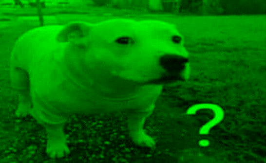
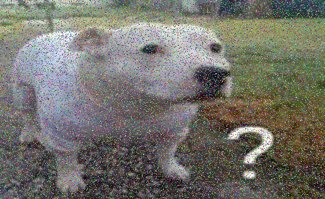
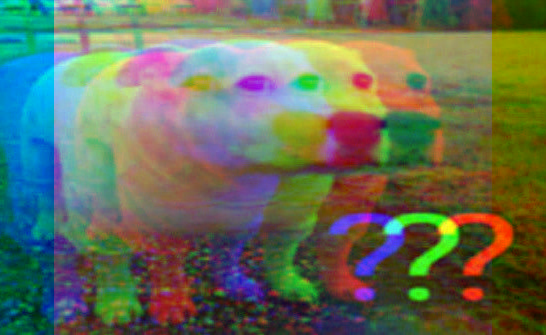
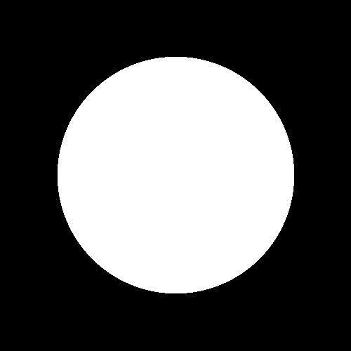
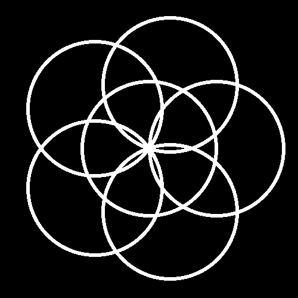
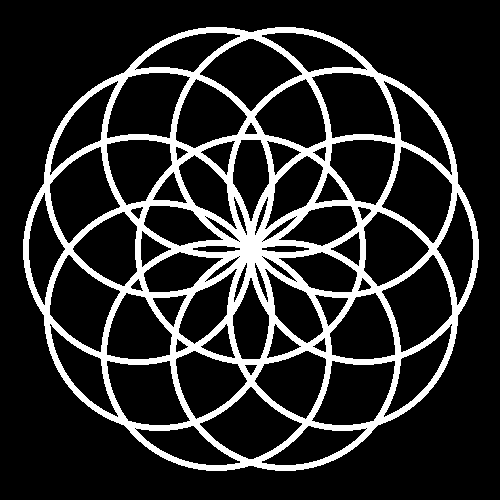
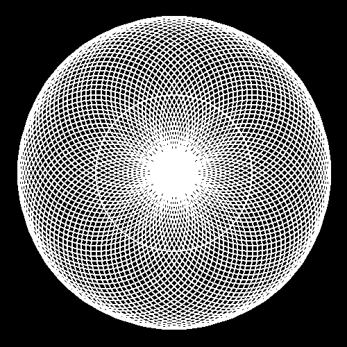

# Mon super compte rendu de WorkShop!
 

Voici tout d'abord l'image avec laquelle j'ai testé tous les effets :

  

## Fonctions

### - Ne garder que le vert :

  

### - Echanger les canaux :

  

### - Noir & Blanc :

  

### - Négatif :

  

### - Dégradé :

  

### - Miroir :

  

### - Image bruitée :

  

### - Rotation de 90° :

  

### - Miroir :

  

### - RGB Split :

  

### - Luminosité :
Eclaircit :

Assombrit :

  

### - Disque :

  

### - Cercle :

  

### - Animation :

  

### - Rosace :
La fonction a plusieurs paramètres (épaisseur des traits, taille de la rosace...) dont un paramètre pour choisir le nombre de pétales.
5 pétales :

10 pétales :

100 pétales :

  